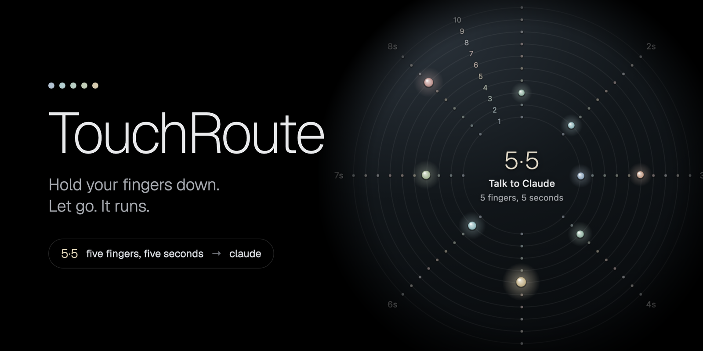
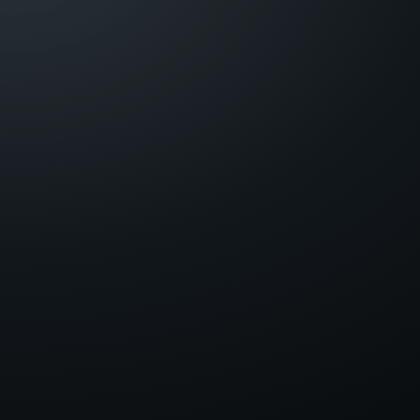
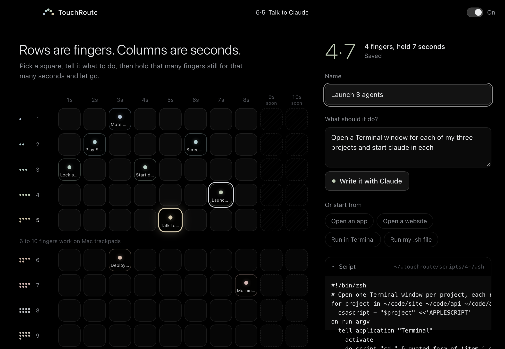

<p align="center">
  
</p>

<p align="center">
  
  
  
  
</p>

<p align="center">
  <b>Your trackpad is a keyboard made of hands.</b><br>
  Put five fingers down. Count to five. Let go. Terminal opens and you're talking to Claude.
</p>

---

## Hold. Count. Let go.

<table>
<tr>
<td width="46%"></td>
<td>

Every combination of **fingers × seconds** is its own shortcut.

Put the fingers down and keep them still. A ring fills one segment per second, showing which touch you're on and what it does. Lift on your number, and it runs.

Move your fingers and it cancels, so scrolling, clicking and dragging never set anything off.

| | Fingers | Seconds | Touches |
|---|:-:|:-:|:-:|
| **macOS** | 1–10 | 1–8 | **80** |
| Windows, Linux *(soon)* | 1–5 | 1–8 | 40 |

</td>
</tr>
</table>

## A buddy that lives on your desktop

<table>
<tr>
<td>

TouchRoute doesn't sit in a window. It's a little swarm of dots floating on your desktop: they drift, breathe, hop, and lean toward your cursor. **Each colored dot is one of your touches.**

Scroll up on it (or double-click) and the dots slowly unfold into a **dial**: rings are fingers, spokes are seconds, and every touch sits in its spot. Point at a dot to see what it does. Click any spot to set it up. Scroll down and they drift back home.

No more forgetting what `4·7` does.

It notices what your Mac is doing, too: the dots doze off with floating z's when you step away (and jump when you come back), get drowsy late at night or on low battery, and break a sweat when your Mac is working hard.

</td>
<td width="52%"></td>
</tr>
</table>

## Set it up by saying what you want



Pick a square, describe it in plain words, and click **Write it with Claude**. The [Claude Code](https://claude.com/claude-code) CLI on your computer writes the script. It runs with every tool turned off, so it can only write text, and you read the script before anything is saved.

Not into AI? Use a quick start (open an app, open a website, run a command in Terminal, run your own `.sh`) or write the script yourself.

### …or just ask your AI

TouchRoute comes with a **[skill](skills/touchroute/SKILL.md)** that teaches AI agents how it works. The installer adds it to Claude Code, so you can ask for touches without opening settings:

> **you:** make four fingers for seven seconds open claude in my three projects
>
> **claude:** Done. `4·7 Launch 3 agents` opens a Terminal window in `~/code/site`, `~/code/api` and `~/code/app`, each running `claude`. Hold 4 fingers still for 7 seconds and let go.

The app picks up changes within a couple of seconds, and the new dot shows up on your buddy. Other agents can use the skill too: point them at [`skills/touchroute/SKILL.md`](skills/touchroute/SKILL.md).

## Install

**macOS (Apple silicon):**

```bash
curl -fsSL https://raw.githubusercontent.com/lalomorales22/touchroute/main/install.sh | bash
```

The installer:

- puts TouchRoute in Applications
- starts it at login (skip with `bash -s -- --no-login`)
- adds the Claude Code skill (skip with `--no-skill`)
- opens the app

Then hold **five fingers for five seconds**. That touch comes set up to open Claude.

Prefer a download? Grab `TouchRoute.dmg` from [Releases](https://github.com/lalomorales22/touchroute/releases). The app isn't notarized yet, so the first time you open it, right-click it and choose **Open**.

**Windows and Linux:** coming soon, with up to 5 fingers.

## Draw to run

Hold **⌥ Option** and draw a shape on your trackpad with one finger. A glowing rainbow line follows your finger across the screen, and when you lift, a shape it knows bursts into light and runs. A heart throws glowing hearts, a circle opens a portal, a check mark fires confetti cannons, a lightning bolt cracks lightning across the screen.

Make your own in **Drawings**: draw a shape two or three times (on the trackpad or with the mouse) so it learns your style, then tell it what to do, the same way as a touch. TouchRoute tells you if a new shape looks too much like one you already have.

## Feel it

On a Force Touch trackpad, TouchRoute taps your finger as each second passes, a little firmer on a square that has a touch, and gives a solid click when a touch fires. You can count without looking. Turn it off with **Trackpad clicks** in settings.

## The fun pack

A fresh install comes with the grid already full of things to try: lightning storms, flames, warp speed, the Matrix, a supernova, a portal, northern lights, a neon sign, a disco ball, confetti cannons, fireworks, a magic 8 ball, dice, dad jokes, and quick ways to open the apps every Mac has. Effects draw over your whole screen for a few seconds, and clicks pass straight through.

Don't want them? **Clear all** under the grid empties it, and **Add fun pack** brings them back without touching your own touches.

## Effects for any script

Every effect is one command, so your own touches can use them too:

```bash
~/.touchroute/bin/touchroute fx lightning
~/.touchroute/bin/touchroute fx neon "SHIP IT"
~/.touchroute/bin/touchroute fx rain "🍕 🧀" "pizza time"
~/.touchroute/bin/touchroute feel strong
```

Effects: `lightning` `fire` `hearts` `warp` `matrix` `confetti` `fireworks` `supernova` `portal` `aurora` `neon` `bubbles` `galaxy` `disco` `snow`, plus the emoji effects `pop` `spin` `rain` `burst` `float` `launch` `banner`. The **Effects** tab in settings plays each one so you can pick. Claude knows about them when it writes a script for you.

## Share packs

A pack is one `.touchroute` file with touches and drawings in it. In **Packs**, save yours to the Desktop and send it to a friend or post it on GitHub. To add one, double-click the file, choose it in settings, or paste a link (a GitHub file, a gist, any https address). You see every square it fills and every script it runs before anything is added, and it only fills empty squares unless you say otherwise.

## Make it yours

The **Buddy** row in settings changes how your dots look:

- **Themes:** Classic, Dusk, Neon, Cosmic (each orb is a glowing galaxy) and Galaxy (each orb is dark, quiet space). The dice picks one at random.
- **Critters:** turns every dot into a little wiggly creature whose eyes follow your cursor.
- **Penguins:** a waddling colony with big eyes, diamond beaks and flapping flippers, tinted by finger count.
- **Chatty:** every 2 to 7 minutes, at random, one of them pipes up in a comic speech bubble: a joke, something sweet, a push to keep going, or a handy Mac tip. It knows the time of day, notices when your Mac is busy, and says hi when you come back. Over a thousand lines. Click the swarm to make one talk right now.
- **Calm to Hyper:** how much the dots wobble, hop and react to your fingers.

## Ideas

| Touch | What it does |
|:-:|---|
| `5·5` | Open Terminal and start Claude |
| `4·7` | Open Claude in three project folders at once |
| `3·4` | Start the dev server and open `localhost:3000` |
| `2·2` | Play Spotify |
| `3·1` | Lock the screen |
| `6·3` | Run your deploy script and notify you when it's done |
| `7·8` | Morning routine: mail, calendar, standup notes, music |

## Under the hood

Everything lives in plain files you can edit, back up or sync:

```
~/.touchroute/
  config.json        your touches and their names
  scripts/5-5.sh     what 5 fingers × 5 seconds runs (plain zsh)
  logs/5-5.log       output from the last run
  drawings/ID.sh     what each saved drawing runs
  bin/touchroute     the command scripts use for effects and clicks
```

- **Trackpad:** on macOS, TouchRoute reads raw contacts from the private `MultitouchSupport` framework (the one BetterTouchTool uses). It needs no permissions and sees all ten fingers.
- **Drawings:** strokes are matched like the $1 recognizer (resampled, centered, scaled), comparing both position and direction along the stroke, so a star never passes for a circle. It handles strokes drawn backwards, tilted, squashed or started anywhere around a closed shape.
- **Haptics:** clicks the trackpad's motor directly where macOS allows it, and otherwise asks AppKit for its standard feedback.
- **Effects:** a see-through, click-through window over the screen draws them on a canvas. Scripts reach the app through a socket in `~/.touchroute`.
- **Detection:** waits ~0.3 s for the finger count to settle, times from the moment the fingers land, ignores a finger that blinks out for a split second, and cancels if anything moves.
- **Scripts:** run in your login shell, so your PATH, tools and aliases work the same as in Terminal.
- **Updates:** when a new release is out, an **Update** button shows up in settings. It downloads the release, swaps the app and reopens it.
- **App:** [Tauri 2](https://tauri.app), a Rust core with a plain HTML/JS interface. About 6 MB.

```
src-tauri/src/touch_macos.rs   trackpad reader
src-tauri/src/detector.rs      fingers + stillness + timing → touch
src-tauri/src/draw.rs          Option-drawing, ink and the shape recognizer
src-tauri/src/haptics.rs       trackpad clicks
src-tauri/src/mood.rs          away, busy and battery, for the buddy
src-tauri/src/fx.rs, ipc.rs    the effects layer and the touchroute command
src-tauri/src/packs.rs         .touchroute packs
src-tauri/src/actions.rs       runs touch scripts
src-tauri/src/ai.rs            asks the claude CLI to write a script
src-tauri/src/update.rs        checks GitHub for a new release and installs it
src-tauri/starter/             the fun pack and drawing pack scripts
ui/fx.*                        every full-screen effect and the drawing ink
ui/buddy.*                     the floating buddy and its dial
ui/settings.*                  the grid and editor
skills/touchroute/SKILL.md     teaches AI agents to set up touches
site/index.php                 landing page
install.sh                     one-line installer
```

### Build from source

```bash
cargo install tauri-cli --version "^2"
cd src-tauri
cargo tauri dev      # run it
cargo tauri build    # .app and .dmg in target/release/bundle
```

To see exactly what the trackpad reports, run `TOUCHROUTE_DEBUG=1 cargo tauri dev`. It prints every change in contacts and finger states. Debug builds also take `TOUCHROUTE_DEMO_DRAW=heart,star` (feeds fake strokes through the drawing pipeline) and `TOUCHROUTE_DEMO_MOOD=away` or `busy`.

## Roadmap

- [ ] Windows: Precision Touchpad through Raw Input
- [ ] Linux: multitouch through evdev
- [ ] Intel Macs, signing and notarization
- [ ] 9 and 10 second holds
- [ ] Touch chains: one touch that runs several in sequence
